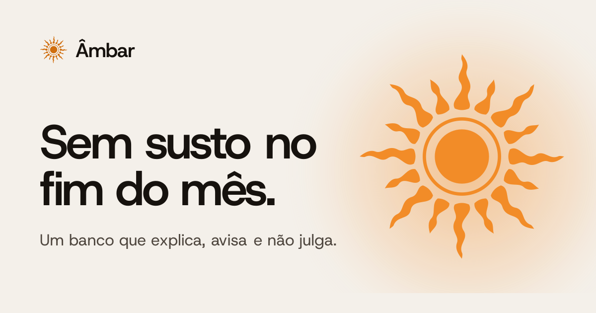
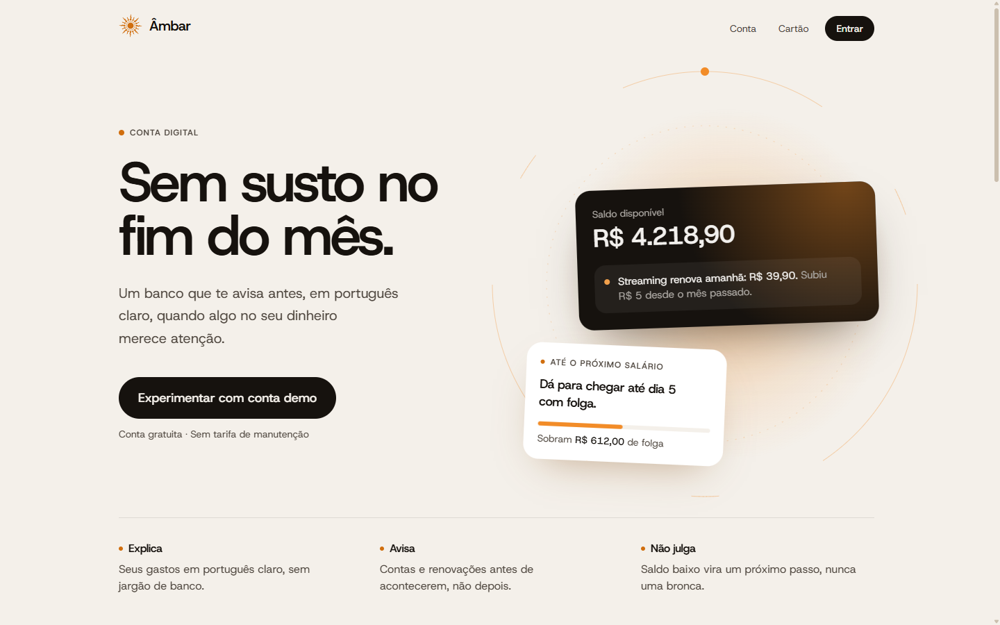
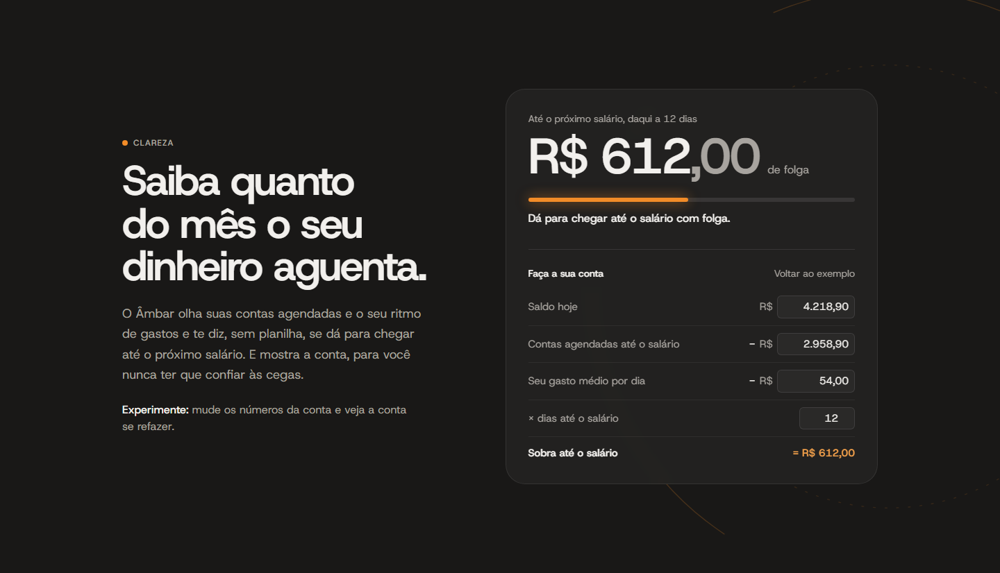
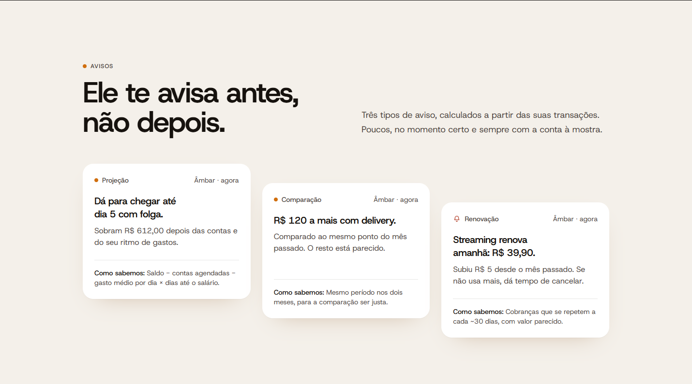
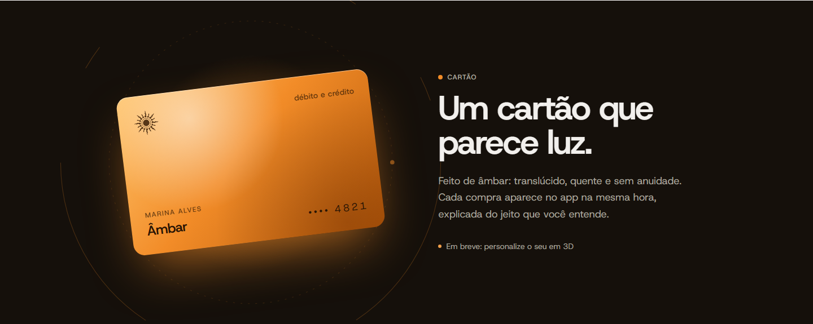
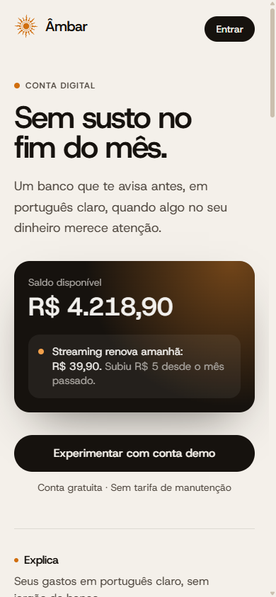
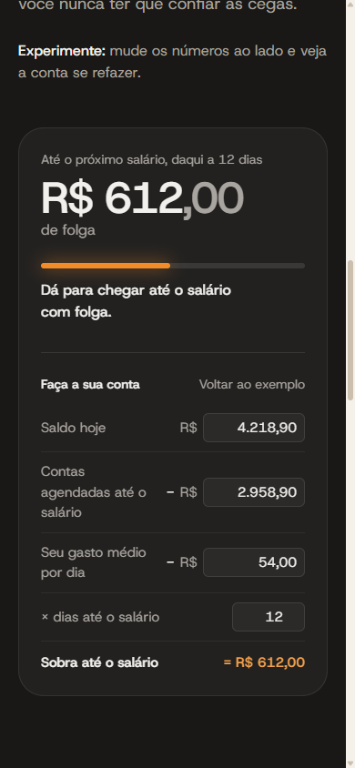
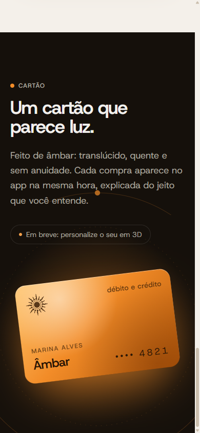

<div align="center">



<br />
<br />


<br />
<br />

**Site e Internet Banking de um banco digital fictício.**<br />
Projeto de portfólio de frontend, feito com processo e qualidade de nível sênior.

[A ideia](#-a-ideia) · [Telas](#-telas) · [Motor de insights](#-o-motor-de-insights) · [Design](#-design-system) · [Rodar](#-rodando-localmente) · [Roadmap](#-roadmap) · [Documentos](#-documentos)

</div>

<br />

> [!NOTE]
> **O Âmbar não é um banco real.** Nenhum dado é coletado, e todos os valores são de demonstração.

<br />

## ☀ A ideia

Os bancos lucram com o que o cliente não sabe, e as páginas deles mostram isso. Contei os links da página inicial de três bancos ([pesquisa completa](docs/research/2026-11-16-landing-bancos.md)):

<div align="center">

|                          | C6 Bank |       Itaú       |      Santander      | **Âmbar** |
| :----------------------- | :-----: | :--------------: | :-----------------: | :-------: |
| Links na página inicial  |   129   |       141        |         117         |   **6**   |
| Abre oferecendo crédito? |   não   | **renegociação** | **limite da conta** | **nunca** |

</div>

O Âmbar faz o contrário. A dor que originou o projeto foi simples: _"elementos demais numa tela só, dá ansiedade só de olhar"_. Então a calma faz parte do produto.

<table>
  <tr>
    <td width="33%" valign="top">
      <h3>Explica</h3>
      Gastos em português claro, e todo número mostra <b>como foi calculado</b>.
    </td>
    <td width="33%" valign="top">
      <h3>Avisa</h3>
      Contas, renovações e aperto no fim do mês, <b>antes</b> de acontecerem.
    </td>
    <td width="33%" valign="top">
      <h3>Não julga</h3>
      Saldo baixo vira um próximo passo, <b>nunca uma bronca</b> em vermelho.
    </td>
  </tr>
</table>

<br />

## ☀ Telas



<p align="center"><sub><b>Hero</b> · o cartão de saldo e a projeção mostram o conceito antes do botão. As órbitas são o anel do logo, ampliado.</sub></p>

<br />



<p align="center"><sub><b>Clareza</b> · um simulador de verdade: mude os números e a conta se refaz, calculada pela mesma função que o dashboard vai usar.</sub></p>

<br />



<p align="center"><sub><b>Avisos</b> · os três tipos de insight. A cor de aviso (o sino) é separada do âmbar da marca, e todo aviso tem ícone além da cor.</sub></p>

<br />



<p align="center"><sub><b>Cartão</b> · 100% CSS, com o sol gravado. Vira a versão 2D de reserva do cartão 3D da Fase 5.</sub></p>

<br />

<div align="center">
  
  &nbsp;
  
  &nbsp;
  
  <p><sub><b>Mobile-first</b> · a partir de 320 px, sem rolagem lateral. No celular, o exemplo aparece antes do botão.</sub></p>
</div>

<br />

## ☀ O motor de insights

Os avisos **não são frases fixas no mock**. São calculados a partir das transações por **funções TypeScript puras**, separadas da interface e testáveis, em [`src/insights/`](src/insights).

|  #  | Regra                         | Como calcula                                                         |
| :-: | :---------------------------- | :------------------------------------------------------------------- |
|  1  | **Projeção até o salário**    | saldo − contas agendadas − gasto médio diário × dias restantes       |
|  2  | **Comparação por categoria**  | o **mesmo período** do mês anterior, para a comparação ser justa     |
|  3  | **Cobrança perto de renovar** | cobranças que se repetem a cada ~30 dias; avisa quando o preço subiu |

```ts
// src/insights/projection.ts — Regra 1, já rodando no simulador da landing
const result = projectUntilPayday({
  balance: 421890, // centavos: R$ 4.218,90
  scheduled: 295890,
  dailySpending: 5400,
  daysLeft: 12,
});
// → { leftover: 61200, status: "comfortable", share: 0.49, dailyCut: 0 }
```

<details>
<summary><b>Por que centavos inteiros, e o que acontece quando falta dinheiro?</b></summary>
<br />

- **Centavos inteiros** (`number`), formatados com `Intl.NumberFormat('pt-BR')`: números decimais erram nas contas com dinheiro (`0.1 + 0.2 !== 0.3`).
- Quando a projeção dá negativo, o status vira `"short"` e a função devolve **quanto cortar por dia** (`dailyCut`), arredondado **para cima**, para nunca recomendar cortar de menos.
- A interface transforma isso em: _"Vai faltar antes do salário. Dá para ajustar gastando R$ 45,00 a menos por dia. Sem drama: dá tempo."_

</details>

<br />

## ☀ Design system

<table>
  <tr>
    <td align="center"><br /><sub><b>paper</b><br /><code>#F4F0EA</code></sub></td>
    <td align="center"><br /><sub><b>ink</b><br /><code>#16120E</code></sub></td>
    <td align="center"><br /><sub><b>graphite</b><br /><code>#191817</code></sub></td>
    <td align="center"><br /><sub><b>resin</b><br /><code>#15100B</code></sub></td>
    <td align="center"><br /><sub><b>amber</b><br /><code>#F28C28</code></sub></td>
    <td align="center"><br /><sub><b>attention</b><br /><code>#B3402A</code></sub></td>
    <td align="center"><br /><sub><b>positive</b><br /><code>#2A7347</code></sub></td>
  </tr>
</table>

- **O âmbar é luz e sinal, nunca fundo de seção.** Uma versão com laranja em áreas grandes parecia app de delivery.
- **Contrastes calculados (WCAG AA)**, não "de olho". Dois tokens reprovaram e foram escurecidos ([tabela](docs/superpowers/specs/2026-11-16-ambar-concept-design.md)).
- **Tipografia:** Host Grotesk, com **números tabulares** em todo valor de dinheiro.
- **Logo:** um sol de realeza, com núcleo, anel de moeda e raios ondulados, e uma versão reduzida para o favicon. [Ver a marca →](docs/brand/ambar-logo.html)
- **Movimento:** CSS puro, com entrada calma e animações guiadas pela rolagem, nativas do navegador. **Zero JavaScript de animação.** Tudo para com `prefers-reduced-motion`.

<br />

## ☀ Rodando localmente

> Requisito: **Node 24+**

```bash
git clone https://github.com/guilhermesolagarcia/Projeto-Banco.git
cd Projeto-Banco
npm install
npm run dev        # → http://localhost:3000
```

| Comando                  | O que faz                                                             |
| :----------------------- | :-------------------------------------------------------------------- |
| `npm run build`          | Build de produção                                                     |
| `npm run lint`           | ESLint                                                                |
| `npm run typecheck`      | Gera os tipos de rota e roda o `tsc`                                  |
| `npm run format`         | Prettier                                                              |
| `npm run check:insights` | Testa as regras do motor de insights (Node puro, até o Vitest chegar) |

<br />

## ☀ Roadmap

Cada ferramenta entra **só quando o problema dela aparece**.

| Fase | Entrega                                              | Ferramentas                                            |     |
| :--: | :--------------------------------------------------- | :----------------------------------------------------- | :-: |
|  0   | Conceito, marca, validação com conselho de IAs, spec | `brainstorming` · `llm-council`                        | ✅  |
|  1   | Fundação e landing                                   | Next.js · TypeScript · Tailwind · ESLint · Prettier    | 🔄  |
|  2   | Login com conta demo                                 | React Hook Form · Zod                                  |     |
|  3   | Dashboard e extrato com o motor de insights          | MSW · TanStack Query · Motion                          |     |
|  4   | Qualidade                                            | Vitest · Testing Library · Playwright · GitHub Actions |     |
|  5   | Cartão 3D personalizável                             | React Three Fiber · drei                               |     |

**Landing:** ✅ hero · ✅ clareza · ✅ avisos · ✅ cartão · ✅ não julga · ✅ perguntas · ⬜ fechamento · ⬜ rodapé

<br />

## ☀ Acessibilidade

- Contraste **AA calculado** em todos os pares de cor.
- Foco visível em âmbar, link "Pular para o conteúdo" e navegação completa por teclado.
- Avisos com **ícone + texto**, nunca só cor, e anunciados por leitor de tela (`aria-live`).
- Formulário do simulador com rótulos reais em todos os campos.
- `prefers-reduced-motion` respeitado em toda animação.

<br />

## ☀ Documentos

<details>
<summary><b>Estrutura do projeto</b></summary>

```
src/
  app/            → rotas, layout, tokens (globals.css), imagem de compartilhamento, 404
  components/     → Logo, Money, ResinCard
  features/       → um módulo por pasta (landing; depois auth e banking)
  insights/       → regras puras do motor de insights (sem React)
docs/
  superpowers/specs/  → conceito e direção visual
  brand/              → página do logo
  research/           → pesquisa de páginas de bancos
  diario/             → diário de bordo
  processo.md         → princípios e kit de skills
SPEC.md           → o que construir, módulo por módulo
```

</details>

| Documento                                                                              | Para quê                                             |
| :------------------------------------------------------------------------------------- | :--------------------------------------------------- |
| [`SPEC.md`](SPEC.md)                                                                   | O que construir, critérios de pronto e limites       |
| [Conceito e direção visual](docs/superpowers/specs/2026-11-16-ambar-concept-design.md) | O porquê: conceito, tokens, logo e motor de insights |
| [Logo](docs/brand/ambar-logo.html)                                                     | Marca completa, versão reduzida e regras de uso      |
| [Pesquisa](docs/research/2026-11-16-landing-bancos.md)                                 | O que os bancos fazem, e o que o Âmbar não faz       |
| [Diário de bordo](docs/diario/2026-11-16.md)                                           | Decisões, erros e lições de cada dia                 |
| [Processo](docs/processo.md)                                                           | Como o projeto é construído com IA, em modo mentor   |

<br />

<div align="center">
<sub>Feito com calma. ☀ Âmbar é um banco fictício, projeto de portfólio.</sub>
</div>
